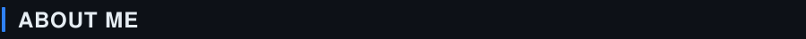
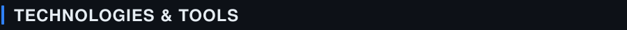
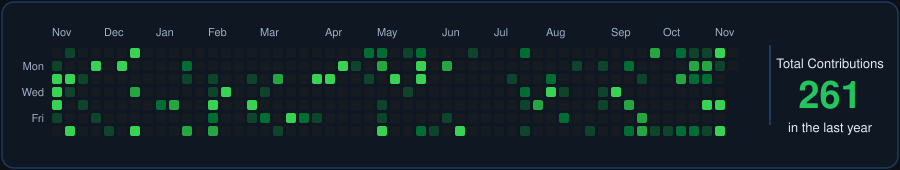
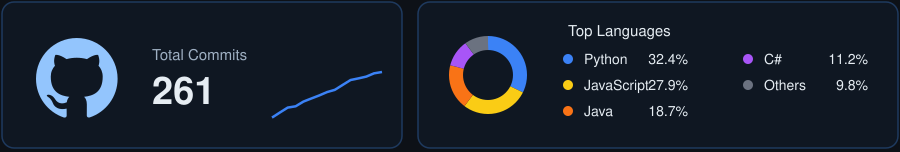
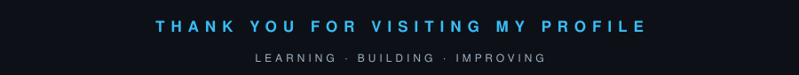

I am a Bachelor of Science in Information Technology student with an interest in web development, backend systems, and software engineering.

&nbsp;•&nbsp; Currently studying Information Technology &nbsp;&nbsp;•&nbsp; Aspiring Web Developer &nbsp;&nbsp;•&nbsp; Interested in building practical software solutions 
&nbsp;•&nbsp; Exploring backend development, databases, and AI &nbsp;&nbsp;•&nbsp; Continuously learning and improving my skills

| PROJECT | DESCRIPTION |
|:---|:---|
| **HotelEase** | Web-Based Hotel Management and Reservation System |
| **Lost-and-Found AI** | AI-Powered Lost Item Matching System |
| **CueTrack** | Production Management System |

